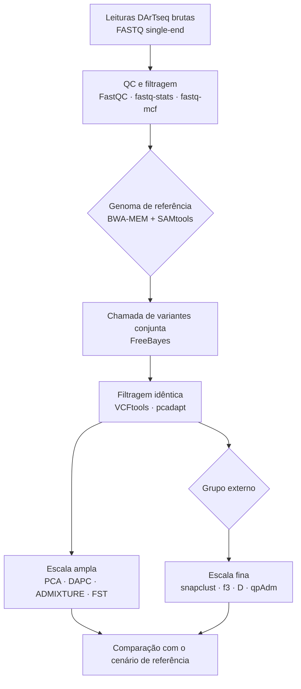

# Nicotiana-bioinformatica

Pipeline reprodutível para o processamento de dados de genotipagem por representação reduzida (DArTseq) de espécies de *Nicotiana* sect. *Alatae*, desenvolvido para o Trabalho de Conclusão de Curso **"A escolha metodológica importa para a inferência de introgressão? Um teste em zonas híbridas de *Nicotiana*"** (Filipe Backes Zatta).

O objetivo do pipeline é processar um mesmo conjunto de leituras sob diferentes combinações de **genoma de referência** e **grupo externo**, mantendo todos os demais parâmetros constantes (inclusive o genotipador, FreeBayes), para medir o efeito dessas escolhas sobre as inferências de estrutura populacional, hibridação e introgressão. O cenário de referência reproduz o pipeline de Couto *et al.* (2026, *Annals of Botany*, doi:[10.1093/aob/mcag083](https://doi.org/10.1093/aob/mcag083)).

> **Estado atual:** a etapa 1 (controle de qualidade e filtragem das leituras) está implementada e funcional. As etapas seguintes estão em desenvolvimento; ver [Estado de implementação](#estado-de-implementação).

---

## Sumário

1. [Delineamento](#delineamento)
2. [Arquitetura](#arquitetura)
3. [Estado de implementação](#estado-de-implementação)
4. [Requisitos](#requisitos)
5. [Estrutura do repositório](#estrutura-do-repositório)
6. [Dados de entrada](#dados-de-entrada)
7. [Execução](#execução)
8. [Saídas](#saídas)
9. [Configuração](#configuração)
10. [Envio automático de resultados](#envio-automático-de-resultados)
11. [Versões dos programas](#versões-dos-programas)
12. [Referências](#referências)

---

## Delineamento

| Fator | Níveis |
|---|---|
| Genoma de referência | *N. langsdorffii* (sect. *Alatae*) · *N. sylvestris* (Sierro *et al.*, 2024; GCF_000393655.2) · *N. benthamiana* (alotetraploide) · *Petunia axillaris* |
| Grupo externo (testes de introgressão) | *N. bonariensis* (amostras DArTseq) · *N. tomentosiformis* (alelos da montagem genômica) |

Leituras, parâmetros de mapeamento, chamada de variantes (FreeBayes v1.3.6), limiares de qualidade e filtros de SNPs são idênticos entre as combinações. As 4 matrizes de SNPs resultantes (uma por referência) são comparadas com o cenário de referência (*N. sylvestris* + *N. bonariensis*). Outros genotipadores (GATK, BCFtools) poderão ser incorporados como fator adicional em etapa posterior.



## Arquitetura

- **Orquestração:** [Snakemake](https://snakemake.readthedocs.io) v7.32.4. O fluxo é descrito como um grafo de dependências entre arquivos (DAG); cada amostra é processada de forma independente e em paralelo.
- **Isolamento de ambiente:** cada regra executa sua ferramenta em um contêiner Docker com versão fixa (imagens BioContainers e StaPH-B). Não é necessário instalar as ferramentas de bioinformática na máquina hospedeira.
- **Execução do orquestrador:** o próprio Snakemake roda em um contêiner (`snakemake/snakemake:v7.32.4`) com acesso ao socket Docker do hospedeiro (padrão *Docker-outside-of-Docker*), de modo que o pipeline pode ser executado em qualquer máquina com Docker, inclusive Windows (Git Bash) e servidores Linux.

## Estado de implementação

| Etapa | Ferramentas | Estado |
|---|---|---|
| 1. QC das leituras brutas | FastQC, fastq-stats | Implementada |
| 2. Remoção de adaptadores e filtragem por qualidade (Q30, ≥ 50 pb) | fastq-mcf | Implementada |
| 3. QC das leituras filtradas e tabela de retenção | FastQC, fastq-stats, Python | Implementada |
| 4. Download e indexação das referências | NCBI FTP, BWA, SAMtools | Planejada (rascunho em `setup_matrix.sh`) |
| 5. Mapeamento, ordenação e métricas | BWA-MEM, SAMtools | Planejada |
| 6. Chamada de variantes | FreeBayes | Planejada |
| 7. Filtragem de SNPs | VCFtools, BCFtools, pcadapt | Planejada |
| 8. Análises populacionais e comparação | R (SNPRelate, adegenet, hierfstat, vegan), ADMIXTURE, ADMIXTOOLS 2 | Planejada (`workflow/scripts/plot_pca.R`) |

## Requisitos

- Docker (Docker Desktop no Windows/macOS ou Docker Engine no Linux), com o daemon em execução.
- Bash. No Windows, Git Bash; a variável `MSYS_NO_PATHCONV=1`, já definida em `iniciar_pipeline.sh`, evita a conversão automática de caminhos.
- Acesso à internet na primeira execução, para baixar as imagens dos contêineres.
- Opcional: `git` com credenciais configuradas, se o envio automático de resultados for mantido.
- Opcional: Python com `streamlit` e `pyyaml`, para o configurador `app.py`.

## Estrutura do repositório

```text
.
├── config/
│   └── config.yaml              # Parâmetros globais (genotipadores, etapas de QC)
├── data/
│   └── raw/
│       ├── reads/               # Leituras brutas {amostra}.FASTQ.gz (não versionadas)
│       └── illumina_adapter.fasta
├── workflow/
│   ├── Snakefile                # Regras do pipeline
│   ├── scripts/
│   │   └── plot_pca.R           # Gráfico de PCA a partir de .eigenvec (PLINK)
│   └── dag.pdf                  # Grafo de dependências atual
├── iniciar_pipeline.sh          # Ponto de entrada: executa o Snakemake em contêiner
├── setup_matrix.sh              # Cria a árvore de diretórios de entrada
├── enviar_resultados.sh         # Copia relatórios e faz commit/push (ver abaixo)
├── app.py                       # Interface Streamlit para editar config.yaml
└── guia.txt                     # Comandos de referência rápida
```

Os diretórios `data/` e `results/` estão no `.gitignore`: dados brutos e resultados intermediários não são versionados.

## Dados de entrada

| Arquivo | Descrição |
|---|---|
| `data/raw/reads/{amostra}.FASTQ.gz` | Uma biblioteca *single-end* por indivíduo, como entregue pela DArT (já demultiplexada). O nome do arquivo, sem a extensão, é usado como identificador da amostra. A extensão deve ser exatamente `.FASTQ.gz` (maiúsculas). |
| `data/raw/illumina_adapter.fasta` | Sequência do adaptador Illumina usada pelo fastq-mcf (`AGATCGGAAGAG`). |

## Execução

### Execução completa em contêiner (recomendada)

```bash
git clone https://github.com/filipezatta/Nicotiana-bioinformatica.git
cd Nicotiana-bioinformatica

# 1. Copiar as leituras para data/raw/reads/
# 2. Iniciar o pipeline
bash iniciar_pipeline.sh
```

O script inicia o contêiner do Snakemake, instala o cliente Docker dentro dele, executa `setup_matrix.sh` e, em seguida, `snakemake --cores 30`. Ajuste o número de núcleos em `iniciar_pipeline.sh` de acordo com a máquina utilizada.

### Execução com Snakemake local

Com um ambiente conda/mamba que contenha o Snakemake (o Docker continua sendo necessário, pois as regras chamam `docker run`):

```bash
mamba activate smk
bash setup_matrix.sh
snakemake --cores 4 -s workflow/Snakefile
```

### Comandos úteis

```bash
# Simulação: lista as tarefas sem executá-las
snakemake -n -s workflow/Snakefile

# Grafo de dependências
snakemake --forceall --dag      -s workflow/Snakefile | dot -Tpdf > workflow/dag.pdf
snakemake --forceall --rulegraph -s workflow/Snakefile | dot -Tpdf > rulegraph.pdf
```

## Saídas

| Caminho | Conteúdo |
|---|---|
| `results/qc/fastqc/raw/{amostra}/` | Relatório FastQC das leituras brutas |
| `results/qc/stats/raw/{amostra}.RAW_stats.txt` | Número de leituras brutas |
| `results/trimmed/reads/{amostra}.trimmed.fastq.gz` | Leituras filtradas (Q30, ≥ 50 pb, sem adaptador) |
| `results/qc/fastqc/trimmed/{amostra}/` | Relatório FastQC das leituras filtradas |
| `results/qc/stats/trimmed/{amostra}.q30l50_stats.txt` | Número de leituras retidas |
| `results/qc/QC_control_table.tsv` | Tabela consolidada por amostra |

Colunas de `QC_control_table.tsv`:

| Coluna | Descrição |
|---|---|
| `targetid` | Identificador da amostra |
| `Raw_reads` | Leituras brutas |
| `Trimmed_Reads_Q30L50` | Leituras retidas após a filtragem |
| `initial_loss` | Leituras descartadas |
| `%_kept` | Proporção de leituras retidas |

## Configuração

`config/config.yaml` define os genotipadores a utilizar e as etapas de QC a executar:

```yaml
genotypers:
- freebayes
qc_steps:
  raw_reads_qc: true
  processed_reads_qc: true
  mapping_qc: true
  sorting_qc: true
  variant_call_qc: true
```

O arquivo é carregado pelo Snakefile, mas suas chaves ainda não controlam as regras; isso será feito à medida que as etapas 4–8 forem implementadas. O arquivo pode ser editado manualmente ou pela interface `streamlit run app.py`.

## Envio automático de resultados

Ao final de uma execução bem-sucedida, o bloco `onsuccess` do Snakefile chama `enviar_resultados.sh`, que:

1. copia `QC_control_table.tsv`, os relatórios FastQC de uma amostra de controle e o log mais recente do Snakemake para `relatorios_finais/`;
2. executa `git add`, `git commit` e `git push` desse diretório.

O envio é feito para o ramo em uso no momento da execução. Para desativá-lo, remova ou comente o bloco `onsuccess` no Snakefile.

## Versões dos programas

| Programa | Versão | Imagem |
|---|---|---|
| Snakemake | 7.32.4 | `snakemake/snakemake:v7.32.4` |
| FastQC | 0.12.1 | `staphb/fastqc:0.12.1` |
| ea-utils (fastq-mcf, fastq-stats) | 1.1.2-779 | `quay.io/biocontainers/ea-utils:1.1.2.779--h9dd4a16_0` |

As versões das ferramentas das etapas seguintes serão fixadas nesta tabela à medida que forem incorporadas.

## Referências

- Andrews S. 2010. FastQC: a quality control tool for high throughput sequence data.
- Aronesty E. 2013. Comparison of sequencing utility programs. *The Open Bioinformatics Journal* 7: 1–8.
- Couto MAMS, Soares LS, Rodrigues DM, *et al.* 2026. Genomic evidence of hybridization between two species in *Nicotiana* sect. *Alatae*. *Annals of Botany*. doi:10.1093/aob/mcag083
- Köster J, Rahmann S. 2012. Snakemake—a scalable bioinformatics workflow engine. *Bioinformatics* 28: 2520–2522.
- Mölder F, Jablonski KP, Letcher B, *et al.* 2021. Sustainable data analysis with Snakemake. *F1000Research* 10: 33.
- Sierro N, Auberson M, Dulize R, Ivanov NV. 2024. Chromosome-level genome assemblies of *Nicotiana tabacum*, *Nicotiana sylvestris*, and *Nicotiana tomentosiformis*. *Scientific Data* 11: 135.
